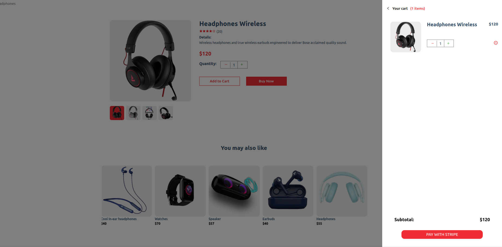
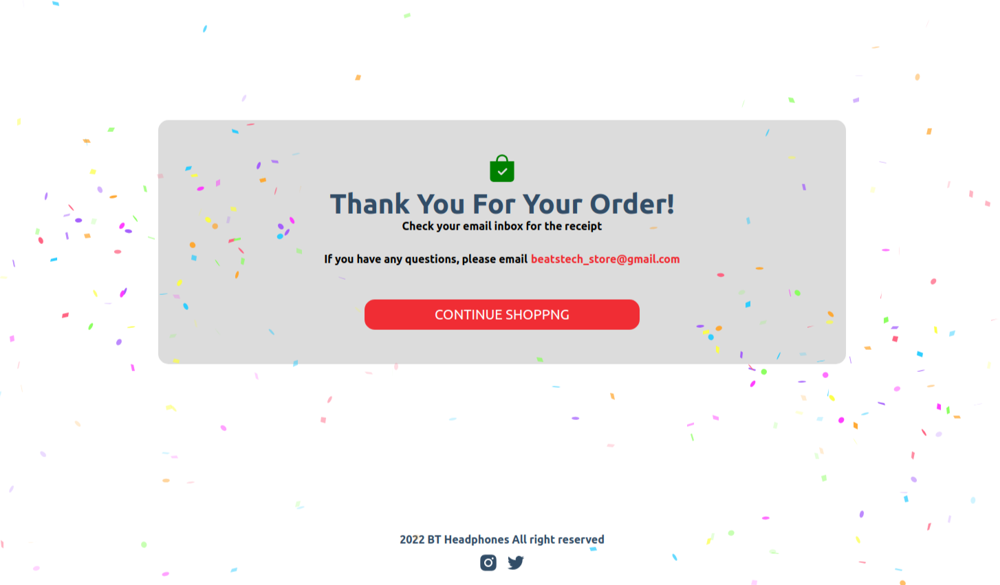

# E-commerce Store – Sanity & Stripe

A modern e-commerce web application built with Next.js, React, Sanity CMS, and Stripe. Users can browse products, view product details, manage their shopping cart, and complete checkout using Stripe's hosted payment page.

## Screenshots

## Screenshots

### Home Page


### Shopping Bag


### Successful Order


## Features

- Browse products and view product details
- Product catalog managed with Sanity CMS
- Add and remove products from the shopping cart
- Increase and decrease product quantities
- Automatically calculate cart totals
- Stripe Checkout integration
- Hosted checkout page for secure test payments
- Success and cancellation pages after checkout
- Responsive user interface

## Technologies

- Next.js
- React
- JavaScript
- Sanity CMS
- Stripe Checkout
- Stripe.js
- Context API
- HTML5
- CSS3

## Payment Integration

The application integrates Stripe Checkout to handle the payment flow.

The checkout process includes:

1. Sending cart items to the backend API.
2. Creating a Stripe Checkout Session.
3. Redirecting the customer to Stripe's hosted checkout page.
4. Processing payments in Stripe Sandbox (Test Mode).
5. Redirecting the customer to the success or cancellation page.

**Note:** Stripe is configured in test mode. No real payments are processed.

First, run the development server:

```bash
npm run dev
# or
yarn dev
```

Open [http://localhost:3000](http://localhost:3000) with your browser to see the result.
```bash
git clone YOUR_REPOSITORY_URL
cd ecommerce-sanity-stripe
```

### 2. Install dependencies

```bash
npm install
```
